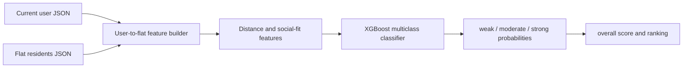
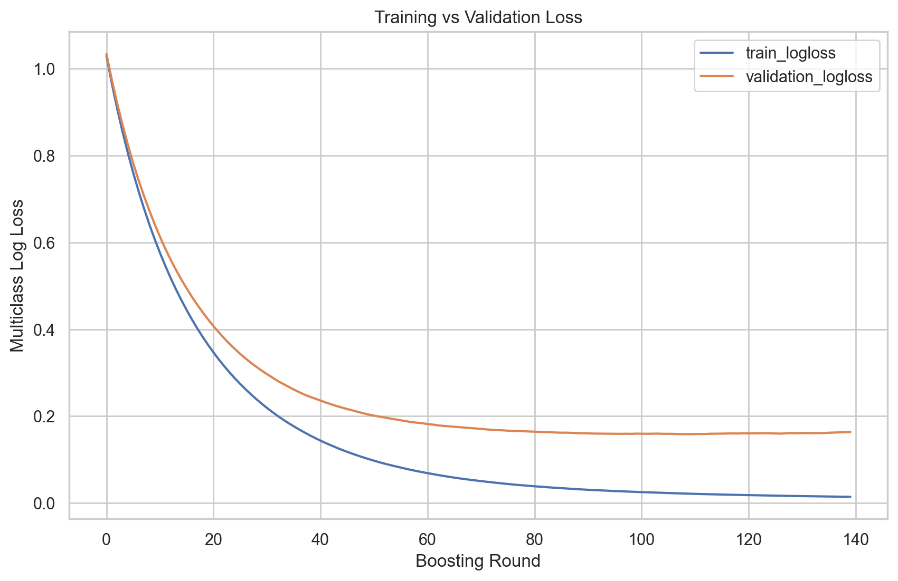
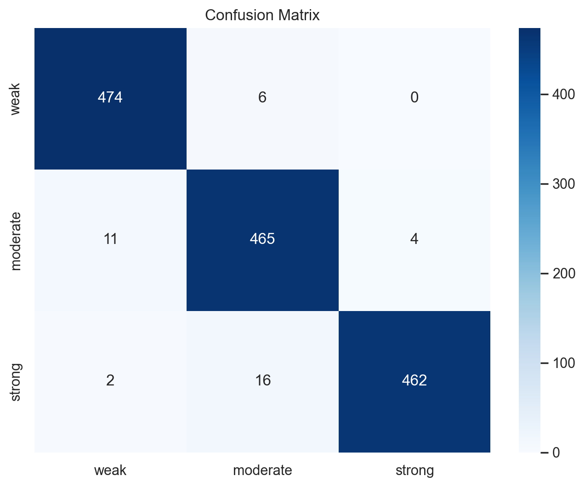
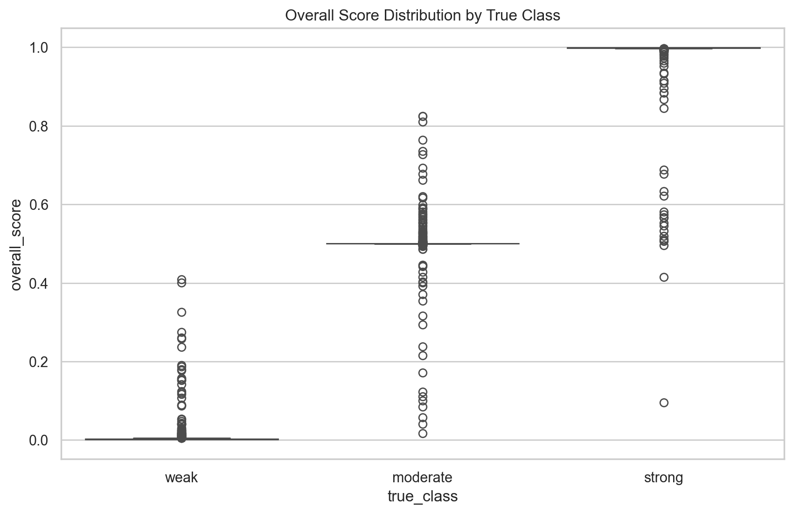
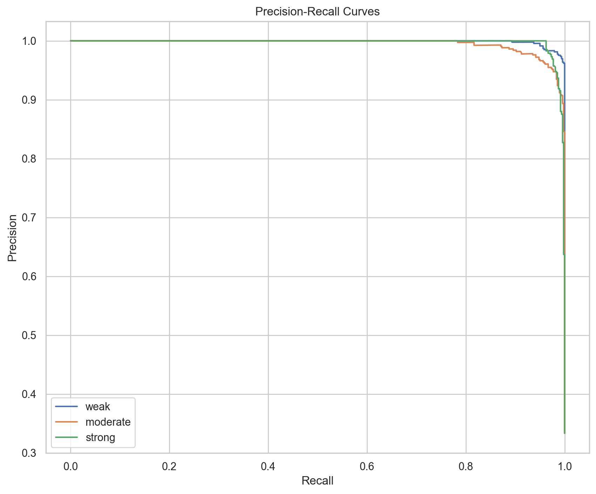
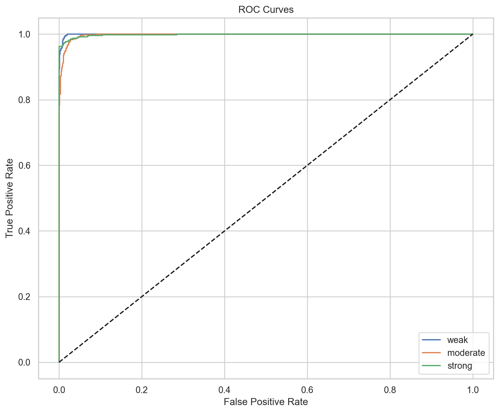
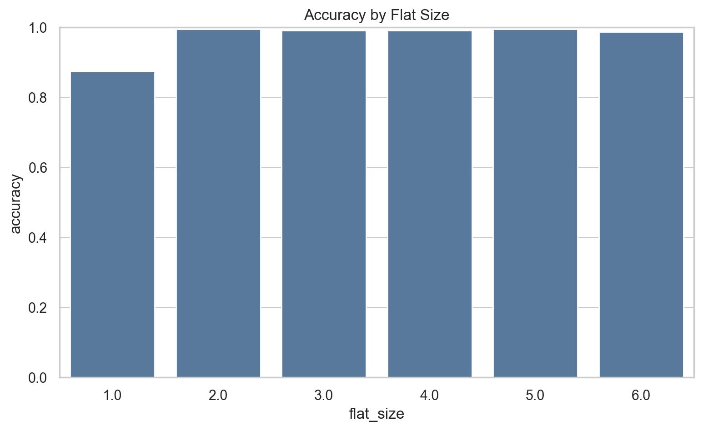
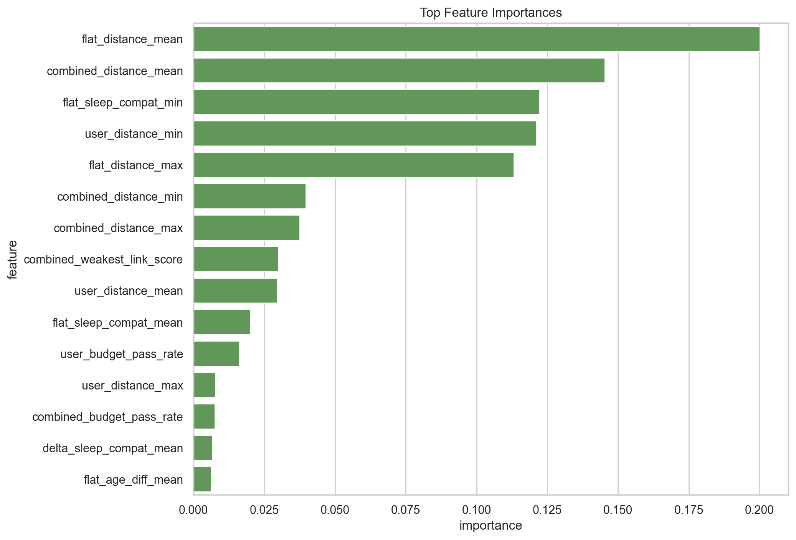

# UniMate User-to-Flat Compatibility Model Report

## 1. Executive Summary
This model scores how compatible the current user is with the residents already living in each flat.

- **Validation Accuracy:** 95.49%
- **Validation Weighted F1:** 0.9549
- **Holdout Accuracy (seed 999):** 97.29%
- **95% Accuracy Confidence Interval:** [96.46%, 97.99%]
- **Weighted One-vs-Rest ROC-AUC:** 0.9984

## 2. Model Architecture


The feature builder mixes direct user-to-resident signals such as budget distance, sleep compatibility, faculty similarity, hometown similarity, and encoded distance metrics with context features from the flat itself.

## 3. Loss Function and Training Dynamics
The classifier is trained with **multiclass log loss (`mlogloss`)**. That loss punishes confident wrong predictions more than uncertain ones, which is important when ranking candidate flats.



The chart shows how training loss and validation loss evolve across boosting rounds. A small gap suggests the model is learning separable compatibility patterns without a major overfitting jump.

## 4. Classification Metrics
| index | precision | recall | f1-score | support |
| --- | --- | --- | --- | --- |
| weak | 0.973305954825462 | 0.9875 | 0.9803516028955532 | 480.0 |
| moderate | 0.9548254620123203 | 0.96875 | 0.9617373319544984 | 480.0 |
| strong | 0.9914163090128756 | 0.9625 | 0.9767441860465116 | 480.0 |
| accuracy | 0.9729166666666667 | 0.9729166666666667 | 0.9729166666666667 | 0.9729166666666667 |
| macro avg | 0.9731825752835527 | 0.9729166666666668 | 0.9729443736321878 | 1440.0 |
| weighted avg | 0.9731825752835527 | 0.9729166666666667 | 0.9729443736321877 | 1440.0 |



| index | weak | moderate | strong |
| --- | --- | --- | --- |
| weak | 474 | 6 | 0 |
| moderate | 11 | 465 | 4 |
| strong | 2 | 16 | 462 |

## 5. Charts and Insights
### 5.1 Score Separation by Class


### 5.2 Precision-Recall Curves


### 5.3 ROC Curves


### 5.4 Accuracy by Flat Size


### 5.5 Feature Importance


Top drivers from the fitted model:

- **flat_distance_mean**: 0.2002
- **combined_distance_mean**: 0.1453
- **flat_sleep_compat_min**: 0.1223
- **user_distance_min**: 0.1212
- **flat_distance_max**: 0.1132

Interpretation: strong predictions usually appear when the current user is close to the flat on the encoded distance features and does not meaningfully damage the flat's combined cohesion after joining.

## 6. API Contract
### Sample Input
```json
{
  "current_user": {
    "student_id": "demo_user_001",
    "gender": "Male",
    "age": 21,
    "budget_range": 0.0498099619923985,
    "sleep_code": 1,
    "faculty": "Faculty of Computers and Artificial Intelligence",
    "hometown_governorate": "Cairo",
    "wants_roommate": 1
  },
  "flats": [
    {
      "flat_id": "demo_flat_1",
      "students": [
        {
          "student_id": "flat_member_1",
          "gender": "Male",
          "age": 22,
          "budget_range": 0.0664799626591985,
          "sleep_code": 2,
          "faculty": "Faculty of Computers and Artificial Intelligence",
          "hometown_governorate": "Cairo",
          "wants_roommate": 1
        }
      ]
    },
    {
      "flat_id": "demo_flat_3",
      "students": [
        {
          "student_id": "flat_member_2",
          "gender": "Male",
          "age": 21,
          "budget_range": 0.0598119623924785,
          "sleep_code": 0,
          "faculty": "Faculty of Computers and Artificial Intelligence",
          "hometown_governorate": "Cairo",
          "wants_roommate": 1
        },
        {
          "student_id": "flat_member_3",
          "gender": "Male",
          "age": 24,
          "budget_range": 0.0331399613255985,
          "sleep_code": 0,
          "faculty": "Faculty of Medicine",
          "hometown_governorate": "Cairo",
          "wants_roommate": 1
        },
        {
          "student_id": "flat_member_4",
          "gender": "Male",
          "age": 20,
          "budget_range": 0.0831499633259985,
          "sleep_code": 0,
          "faculty": "Faculty of Engineering",
          "hometown_governorate": "Cairo",
          "wants_roommate": 1
        }
      ]
    }
  ],
  "sort_descending": true
}
```

### Sample Output
```json
{
  "current_user_id": "demo_user_001",
  "request_count": 2,
  "scored_count": 2,
  "rejected_count": 0,
  "flat_scores": [
    {
      "flat_id": "demo_flat_1",
      "status": "scored",
      "overall_score": 0.7909,
      "compatibility_label": "strong",
      "probabilities": {
        "weak": 0.0105,
        "moderate": 0.397,
        "strong": 0.5924
      },
      "metrics": {
        "flat_size": 1,
        "user_budget_diff_mean": 0.0167,
        "user_sleep_compat_mean": 0.5,
        "user_hometown_sim_mean": 1.0,
        "user_faculty_sim_mean": 1.0,
        "user_distance_mean": 0.401,
        "user_distance_max": 0.401,
        "flat_distance_mean": 0.0,
        "combined_distance_mean": 0.401,
        "combined_weakest_link_score": 0.7138,
        "user_budget_fit_pass_rate": 1.0
      },
      "notes": [
        "Score reflects how well the current user matches the residents already inside this flat.",
        "Flat internal cohesion is used only as context, not as the final target being scored."
      ]
    },
    {
      "flat_id": "demo_flat_3",
      "status": "scored",
      "overall_score": 0.6562,
      "compatibility_label": "moderate",
      "probabilities": {
        "weak": 0.0083,
        "moderate": 0.671,
        "strong": 0.3207
      },
      "metrics": {
        "flat_size": 3,
        "user_budget_diff_mean": 0.02,
        "user_sleep_compat_mean": 0.5,
        "user_hometown_sim_mean": 1.0,
        "user_faculty_sim_mean": 0.5333,
        "user_distance_mean": 0.4236,
        "user_distance_max": 0.4658,
        "flat_distance_mean": 0.2943,
        "combined_distance_mean": 0.359,
        "combined_weakest_link_score": 0.6822,
        "user_budget_fit_pass_rate": 1.0
      },
      "notes": [
        "Score reflects how well the current user matches the residents already inside this flat.",
        "Flat internal cohesion is used only as context, not as the final target being scored."
      ]
    }
  ],
  "rejected_flats": []
}
```

