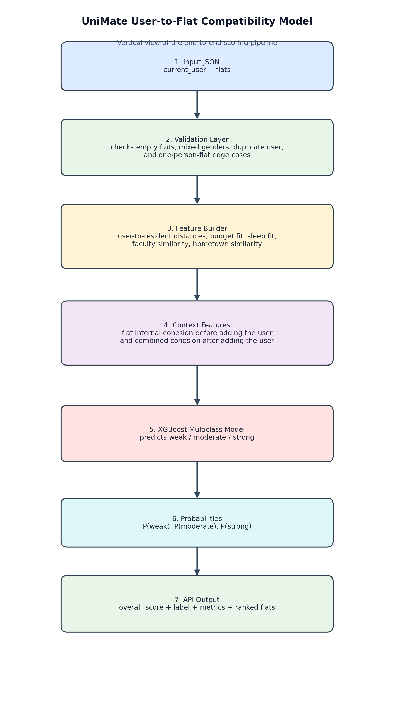

# UniMate System Guide

This document explains the current UniMate system in simple language with enough technical depth to make the model, the API, the charts, and the project files easy to understand and present.

## 1. What The System Does

UniMate helps rank available flats for one student.

The system receives:

- one `current_user`
- a list of candidate `flats`

It returns:

- a score for each flat
- a label for each flat: `weak`, `moderate`, or `strong`
- supporting metrics that explain the score

In product terms, the system answers one business question:

> "Which available flat is the best social and practical fit for this student?"

That matters because housing choice is not only about price or vacancy. It is also about daily-life compatibility, which affects satisfaction, conflict risk, and retention.

## 2. API Input And Output

This section explains what the API expects and what it returns.

### 2.1 Input structure

The request has three top-level parts:

- `current_user`: the student who needs a recommendation
- `flats`: the candidate flats to score
- `sort_descending`: whether to return the best-scoring flats first

### 2.2 `current_user` and resident fields

Each student object uses the same fields:

- `student_id`: a unique identifier for the student
- `gender`: the student gender used for validation and model routing
- `age`: the student age
- `budget_range`: a normalized budget value between `0.0` and `1.0`
- `sleep_code`: a numeric code for sleeping habit
- `faculty`: the study field or faculty
- `hometown_governorate`: the home governorate
- `wants_roommate`: whether the student wants shared living, usually `1` for yes or `0` for no

### 2.3 Sleep habit mapping

The `sleep_code` values are:

- `0` = early sleeper
- `1` = flexible sleeper
- `2` = late sleeper

Why this matters:

- the model uses the distance between sleep codes when estimating compatibility
- `1` sits between the two extremes, so a flexible sleeper is treated as partly compatible with both early and late sleepers
- `0` and `2` are the farthest apart, so they represent the strongest sleep-habit conflict

### 2.4 Output structure

The API response returns:

- `current_user_id`: the student being matched
- `request_count`: how many flats were sent
- `scored_count`: how many flats were successfully scored
- `rejected_count`: how many flats were rejected safely
- `flat_scores`: the scored flats
- `rejected_flats`: flats that were not scored and the reason why

### 2.5 What one scored flat contains

Each item in `flat_scores` includes:

- `flat_id`: the flat identifier
- `status`: usually `scored`
- `overall_score`: the ranking score used to sort flats
- `compatibility_label`: `weak`, `moderate`, or `strong`
- `probabilities`: the class probabilities behind the label
- `metrics`: summary numbers that explain the match
- `notes`: short interpretation notes

### 2.6 How to explain the output to non-technical people

The easiest explanation is:

- `overall_score` tells us where this flat should appear in the ranking
- `compatibility_label` gives a simple human summary
- `probabilities` show confidence
- `metrics` explain why the model leaned toward that result
- `rejected_flats` show that bad input is handled safely instead of crashing the system

## 3. End-To-End Flow

Here is the full flow in plain language:

1. A client sends one student profile and a list of flats to the API.
2. The API checks that the request is valid and safe to score.
3. The system converts the user and the flat residents into measurable compatibility features.
4. The model estimates the probability that the match is `weak`, `moderate`, or `strong`.
5. The API converts those probabilities into an `overall_score`.
6. The flats are sorted from best match to worst match.
7. The response returns both ranking data and explanation data.

This design is useful for business because it does not only produce an answer. It also produces enough evidence to justify the answer.

## 4. System Architecture

The architecture is shown below:

How to read the picture:

- `Input JSON`: the raw student and flat data sent by the client.
- `Validation Layer`: checks for payload issues before scoring.
- `Feature Builder`: converts raw profile data into compatibility measurements.
- `Context Features`: measures the flat environment as a group, not only one-to-one similarity.
- `XGBoost Model`: predicts the class probabilities.
- `Probabilities`: tells how likely the flat is to be `weak`, `moderate`, or `strong`.
- `API Output`: returns the ranking result in a format that product teams can use directly.

## 5. Model Architecture In Simple Technical Terms

The model is an `XGBoost` multiclass classifier. It is not a neural network. It is a boosted tree model that learns decision patterns from numeric features.

Why this is a good choice:

- it works well with structured tabular data
- it handles mixed feature signals well
- it gives strong predictive performance without needing huge datasets
- it is easier to explain than many deep-learning approaches

### 5.1 What the model actually learns from

The model does not read the raw JSON directly. It learns from engineered numeric features such as:

- budget fit
- age difference
- sleep habit compatibility
- hometown similarity
- faculty similarity
- encoded distance between the current user and each resident
- flat-level context after adding the user

These features matter because they represent the practical and social patterns that usually shape whether shared living will feel easy or difficult.

### 5.2 Main feature groups

#### User-to-flat closeness

These features measure how similar the user is to the current residents overall.

Examples:

- `user_distance_mean`
- `user_distance_min`
- `user_distance_max`

Business meaning:

- lower distance usually means easier fit
- a very high maximum distance may reveal one resident who is likely to clash with the candidate

#### Budget fit

These features measure whether the user financially fits the flat.

Examples:

- `user_budget_diff_mean`
- `user_budget_diff_max`
- `user_budget_fit_pass_rate`

Business meaning:

- this reduces the risk of recommending a flat that looks socially good but is financially unrealistic

#### Daily routine fit

These features mainly capture sleep compatibility.

Examples:

- `user_sleep_compat_mean`
- `user_sleep_compat_min`

Business meaning:

- students can be similar on paper but still live badly together if their daily routines conflict

#### Social similarity

These features capture similarities in hometown region and faculty cluster.

Examples:

- `user_hometown_sim_mean`
- `user_faculty_sim_mean`

Business meaning:

- these are not strict rules, but they can be useful signals for comfort, shared context, and communication style

#### Flat context

These features describe the flat as a group after adding the user.

Examples:

- `flat_distance_mean`
- `combined_distance_mean`
- `combined_weakest_link_score`

Business meaning:

- a flat recommendation should not only look good for one pair
- it should also make sense for the group as a whole

### 5.3 Output classes

The model predicts three classes:

- `weak`: the user is likely to be a poor fit
- `moderate`: the match is acceptable but not especially strong
- `strong`: the user looks like a very good fit

### 5.4 Overall score

The API converts the class probabilities into one ranking score:

`overall_score = 0.0 * P(weak) + 0.5 * P(moderate) + 1.0 * P(strong)`

Why this matters:

- product teams need one value for ranking
- presentation teams still need the probabilities for explanation
- the class label remains easy for non-technical audiences to understand

## 6. Loss Function

The model is trained with multiclass log loss, called `mlogloss` in XGBoost.

Simple meaning:

- if the model is correct and confident, loss gets smaller
- if the model is wrong and confident, loss gets much larger

Why this matters to the business:

- the system is used for ranking, not only for hard classification
- ranking quality depends on good probabilities, not only correct labels
- lower log loss means the model is not just guessing the right bucket; it is assigning confidence more intelligently

## 7. How Training Works

The training pipeline builds a synthetic learning dataset from the base student pool stored in `artifacts/unimate_matcher.joblib`.

### 7.1 What the base artifact contains

The base artifact provides:

- male and female student pools
- the transformers used to encode profile information
- the feature weights used in distance calculations
- the budget threshold used by compatibility rules

### 7.2 How training samples are generated

For each gender pool and for flat sizes from 1 to 6, the generator creates examples by:

1. sampling a flat
2. selecting a candidate user
3. building user-to-flat features
4. assigning a label of `weak`, `moderate`, or `strong`

This gives the model many controlled examples of what good, medium, and poor fit look like.

### 7.3 What the saved outputs are

After training, the pipeline saves:

- the trained model
- the feature order
- the training metadata
- a snapshot of the generated dataset

These files matter because they make the model reproducible and deployable.

## 8. How Runtime Scoring Works

When a live API request arrives, the system performs these steps:

1. reads the `current_user`
2. loops through each flat
3. validates the flat payload
4. creates the same features used during training
5. runs the trained model
6. computes the final score
7. returns ranked flats plus rejected flats if any input is unsafe

This is important in production because one bad flat should not break the whole request.

## 9. Safety And Edge Cases

The API has explicit handling for cases that commonly break matching systems:

- one-person flats
- mixed-gender flats
- user gender mismatch with flat residents
- duplicate user already listed inside a flat
- empty or invalid batch structures
- per-flat scoring failures

Business value:

- fewer production crashes
- clearer rejection messages
- safer behavior when real-world input is messy

## 10. What Each Graph Means

This section explains what every chart is for, why it matters, and how to talk about it in a presentation.

### 10.1 `loss_curve.png`

What it shows:

- training loss and validation loss across boosting rounds

Why it matters:

- this is the main chart for checking whether the model is learning in a stable way
- a large gap would suggest overfitting
- a downward validation trend suggests the model is improving rather than memorizing noise

Why the business should care:

- this chart helps justify that the model is reliable enough to move from experiment to product support

Presentation note:

- say that the model becomes more accurate as training progresses and does not show a dangerous separation between training and validation behavior

### 10.2 `confusion_matrix.png`

What it shows:

- how often the model predicts each class correctly and where it makes mistakes

What the current result says:

- `weak` is predicted correctly `474` times out of `480`
- `moderate` is predicted correctly `465` times out of `480`
- `strong` is predicted correctly `462` times out of `480`

Why it matters:

- this is the clearest chart for showing model error behavior
- it shows whether the system confuses good matches with bad ones

Why the business should care:

- wrong classifications can lead to poor recommendations
- this chart shows that the model separates clear bad fits and clear strong fits very well

Presentation note:

- explain that most errors happen between neighboring categories such as `moderate` and `strong`, which is more acceptable than mixing `weak` with `strong`

### 10.3 `score_distribution_by_class.png`

What it shows:

- how the overall scores are distributed for the three classes

Why it matters:

- it shows whether the ranking score behaves logically
- a healthy chart shows low scores for `weak`, high scores for `strong`, and `moderate` in between

Why the business should care:

- the final product ranks flats, so this chart is direct evidence that the score is useful for sorting choices

Presentation note:

- describe this as the "ranking quality" chart because it connects the model output directly to the recommendation experience

### 10.4 `pr_curves.png`

What it shows:

- precision-recall trade-offs for each class

Why it matters:

- precision tells us how often a predicted class is truly correct
- recall tells us how much of the real class the model successfully captures

Why the business should care:

- if the system says a flat is `strong`, the business needs confidence that it really is strong
- this chart helps explain class quality beyond simple accuracy

Presentation note:

- say that this chart is especially useful when the cost of a false positive recommendation matters

### 10.5 `roc_curves.png`

What it shows:

- how well the model ranks true class membership above false class membership

What the current result says:

- weighted ROC-AUC is about `0.9984`

Why it matters:

- this is a strong ranking-quality metric
- high ROC-AUC means the model is very effective at ordering better matches above worse ones

Why the business should care:

- the product experience depends on showing the better options first

Presentation note:

- present this as evidence that the system is not only classifying well; it is also ranking well

### 10.6 `accuracy_by_flat_size.png`

What it shows:

- model accuracy for flats of different sizes

What the current result says:

- size `1` is the hardest case at `87.50%`
- sizes `2` to `6` are all near `99%`

Why it matters:

- it reveals where the system is strongest and where it has less context

Why the business should care:

- this helps define operational expectations
- it shows that recommendations are strongest when the flat has more resident information

Presentation note:

- say that the model remains strong on small flats, but naturally becomes more stable when it can see a richer group pattern

### 10.7 `feature_importance.png`

What it shows:

- which features influence the trained model most

Important signals:

- `flat_distance_mean`
- `combined_distance_mean`
- `flat_sleep_compat_min`
- `user_distance_min`
- `flat_distance_max`

Why it matters:

- this chart explains what the model pays attention to
- it helps move the discussion from "the AI decided" to "the AI relied on these measurable factors"

Why the business should care:

- this improves trust
- it also helps guide future product design, such as which profile fields deserve the most data quality attention

Presentation note:

- explain that the model cares strongly about overall closeness and weakest-link effects, which matches how shared living usually works in real life

## 11. What The Report CSV Files Mean

### 11.1 `classification_metrics.csv`

Contains precision, recall, F1-score, and support for each class.

Why it matters:

- this is the numeric summary behind the report tables

### 11.2 `classification_confusion_matrix.csv`

Contains the raw numbers used to build the confusion matrix.

Why it matters:

- this is the audit table for class-level errors

### 11.3 `accuracy_by_flat_size.csv`

Contains the exact values behind the flat-size accuracy chart.

Why it matters:

- this makes performance by scenario easy to review outside the chart

### 11.4 `feature_importance.csv`

Contains the exact feature-importance values.

Why it matters:

- this is useful for deeper analysis and documentation

### 11.5 `holdout_predictions.csv`

Contains row-level holdout predictions, probabilities, and overall scores.

Why it matters:

- this is the best file for auditing individual prediction behavior

## 12. Presentation Notes

A clear presentation sequence is:

1. define the product problem
2. show the architecture image
3. explain the feature groups in plain language
4. show the confusion matrix and score distribution
5. show loss, ROC, PR, and flat-size accuracy
6. finish with feature importance and the API example

Good talking points:

- the system ranks flats, not just labels them
- the score is useful for product decisions because it combines probability and ordering
- the charts show both accuracy and trustworthiness
- one-person flats are supported, even though they are naturally harder than larger flats
- the API is designed to fail safely on problematic input

## 13. File Purpose Guide

This section focuses on the current active project files.

### 13.1 Core application files

- `api.py`: the live FastAPI application that receives requests, validates payloads, scores flats, and returns results
- `model_utils.py`: the shared logic for normalization, similarity rules, distance summaries, and compatibility feature creation
- `train_flat_model.py`: the training pipeline that generates data, trains the XGBoost classifier, and saves the production artifacts
- `evaluate_flats.py`: the evaluation pipeline that builds the report package, charts, and formal report
- `requirements.txt`: the dependency list for the main project

### 13.2 Active model artifacts

- `artifacts/unimate_matcher.joblib`: the base student-pool artifact and transformer bundle used by training and inference
- `artifacts/user_flat_compatibility_model/compatibility_model.joblib`: the deployed trained model
- `artifacts/user_flat_compatibility_model/feature_names.json`: the exact feature order expected by the model
- `artifacts/user_flat_compatibility_model/model_metadata.json`: training summary and saved metrics
- `artifacts/user_flat_compatibility_model/training_dataset_snapshot.csv`: a saved sample of the training dataset for inspection

### 13.3 Report package files

- `reports/user_flat_compatibility/UNIMATE_COMPATIBILITY_REPORT.md`: the formal report for metrics, evidence, and sample API I/O
- `reports/user_flat_compatibility/UNIMATE_SYSTEM_GUIDE.md`: this explanation document
- `reports/user_flat_compatibility/MODEL_ARCHITECTURE.png`: the architecture image used in presentations and documentation
- `reports/user_flat_compatibility/loss_curve.png`: model-learning stability chart
- `reports/user_flat_compatibility/confusion_matrix.png`: class-level error chart
- `reports/user_flat_compatibility/score_distribution_by_class.png`: ranking-separation chart
- `reports/user_flat_compatibility/pr_curves.png`: precision-recall analysis chart
- `reports/user_flat_compatibility/roc_curves.png`: ranking-discrimination chart
- `reports/user_flat_compatibility/accuracy_by_flat_size.png`: scenario-specific accuracy chart
- `reports/user_flat_compatibility/feature_importance.png`: feature influence chart
- `reports/user_flat_compatibility/classification_metrics.csv`: class metric table
- `reports/user_flat_compatibility/classification_confusion_matrix.csv`: raw confusion matrix values
- `reports/user_flat_compatibility/accuracy_by_flat_size.csv`: raw accuracy-by-size values
- `reports/user_flat_compatibility/feature_importance.csv`: raw feature importance values
- `reports/user_flat_compatibility/holdout_predictions.csv`: row-level evaluation output

### 13.4 Deployment files

- `deployment/unimate-ai/Dockerfile`: container startup instructions for deployment
- `deployment/unimate-ai/README.md`: deployment-facing usage guide
- `deployment/unimate-ai/api.py`: deployment copy of the API
- `deployment/unimate-ai/model_utils.py`: deployment copy of shared scoring logic
- `deployment/unimate-ai/requirements.txt`: deployment dependency list
- `deployment/unimate-ai/artifacts/unimate_matcher.joblib`: deployment copy of the base artifact
- `deployment/unimate-ai/artifacts/user_flat_compatibility_model/compatibility_model.joblib`: deployment copy of the trained model
- `deployment/unimate-ai/artifacts/user_flat_compatibility_model/feature_names.json`: deployment copy of the feature schema
- `deployment/unimate-ai/artifacts/user_flat_compatibility_model/model_metadata.json`: deployment copy of the model summary

## 14. Best Reading Order

If someone wants to understand the project quickly, this order works best:

1. `reports/user_flat_compatibility/UNIMATE_SYSTEM_GUIDE.md`
2. `api.py`
3. `model_utils.py`
4. `train_flat_model.py`
5. `evaluate_flats.py`
6. `reports/user_flat_compatibility/UNIMATE_COMPATIBILITY_REPORT.md`

## 15. Final Mental Model

The simplest way to understand UniMate is:

- the API asks, "Which flat fits this user best?"
- the feature layer turns profile information into measurable compatibility signals
- the model estimates match quality
- the report package proves the quality of those estimates
- the deployment folder contains the files needed to ship the system

So this project is a full recommendation pipeline, not only a model and not only an API.
